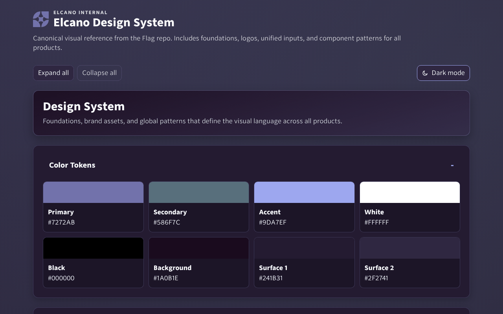
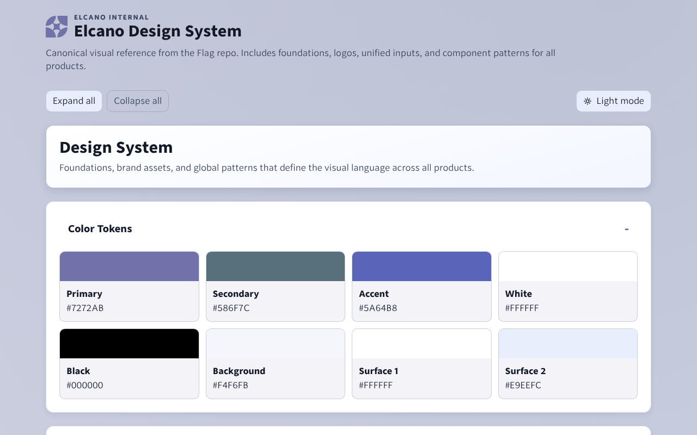

# Flag

**Flag is the design system behind every Elcano product**: one set of tokens,
two typefaces, one icon sprite, the approved logos, a light/dark theme
contract and the component specs that Lens, Explorer, Pages, Home, Auth,
Voice, Manifest and Fleet all build on. It is the source of truth for design;
products copy its files verbatim and never patch their copies.

**Live preview: <https://flag-71q.pages.dev/>**

<p align="center">
  
  
</p>

## What is in it

- **Tokens** for color, type, spacing, radius, shadow, gradients and motion,
  in CSS (`design-tokens.css`, what products load) and JSON
  (`design-tokens.json`, for tools). CI keeps the two identical and measures
  every text, badge, fill and focus-ring pair against WCAG AA in both themes.
- **Two typefaces**, self-hosted: Nebula Sans for text and Hack for code, in
  one font sheet.
- **72 stroke icons** in one SVG sprite, and the Elcano and product **logos**.
- **A theme contract**: `html[data-theme="light|dark"]`, system default,
  explicit choice stored under `flag-theme-preference`, and a small
  dependency-free controller.
- **Component specs** (buttons, inputs, date picker, upload, chips, segmented
  control, tables, connection picker, logs/code display, email) with
  required states and accessibility behavior, and **`components.css`**, the
  plain-CSS implementation of them that server-rendered (Tier A) products
  vendor and the preview itself loads.
- **An email-safe HTML template** for generated reports, with its own limits
  and dark-mode guidance.

## Quick start

Preview it locally (Python 3 is the only requirement):

```bash
git clone https://github.com/ElcanoTek/flag.git
cd flag
make preview          # serves design-system/ on http://localhost:8765/preview/
```

Run every check CI runs (no npm, no network):

```bash
make check
```

Use it in a page:

```html
<link rel="stylesheet" href="/static/flag/fonts/fonts.css" />
<link rel="stylesheet" href="/static/flag/tokens/design-tokens.css" />
<link rel="stylesheet" href="/static/flag/components/components.css" />
<script src="/static/flag/theme/theme-controller.js"></script>

<button class="btn btn-primary" type="button">Save</button>
<svg class="icon" aria-hidden="true"><use href="/static/flag/icons/core-icons.svg#download"></use></svg>
```

```css
.panel {
  background: var(--gradient-surface-panel);
  border: 1px solid var(--color-border);
  border-radius: var(--radius-lg);
  color: var(--color-text-primary);
}
```

`components.css` is the vendorable component layer: the `.btn`, form,
chip, card, badge, table, icon, segmented-control and other classes
`COMPONENTS.md` specifies, in plain CSS that reads tokens (the preview uses
the same file). Product CSS reads tokens too and never hardcodes a color,
radius, spacing value or font family. Start with [`design-system/AGENT_GUIDE.md`](design-system/AGENT_GUIDE.md).

## How products consume Flag

Products **vendor** Flag: they copy the files they use into their own repo and
serve them from their own binary (no CDN, no runtime dependency on this repo).

- `flag.lock` at the product root records the Flag commit and the sha256 of
  every vendored file.
- `scripts/flag-sync.sh` (shared verbatim by every product) adds files
  (`add`), re-copies them at a newer Flag commit (`sync`), reports what is
  stale (`status`), and fails CI on any hand edit (`check`).
- **On every PR** the product's CI runs the offline `check` (through
  `scripts/stack-check.sh`). **Every week** a `flag-drift` workflow checks out
  this repo's `main` and runs `status`, reporting when Flag has moved on.
- Products vendor [`design-system/LICENSE`](design-system/LICENSE) next to
  their copies so the MIT notice travels with them.
- A product that needs a new icon, logo, token or a fix asks for it here and
  re-syncs; it never edits its copy.
- The canonical `flag-sync.sh`, `stack-check.sh`, `flag-drift.yml` and the
  shared `AGENTS.md` standard block ship in [`tools/product/`](tools/product/README.md),
  with the commands to bootstrap a new product.

The full contract, including the rules this repo follows so files stay safe
to copy, is in
[`APPLY_TO_PRODUCT.md` "Vendoring and drift"](design-system/APPLY_TO_PRODUCT.md#vendoring-and-drift).

## shadcn registry

Tier B products (React + Vite; see the Elcano frontend standard in
[`tools/product/agents-standard-block.md`](tools/product/agents-standard-block.md))
take their base UI from shadcn/ui: `npx shadcn add <component>` from the
standard shadcn registry copies the component into the app, where it is
reviewed like the app's own code. The components read shadcn's CSS variables;
point those at Flag's tokens (vendor `tokens/design-tokens.css` and the fonts
first) and they follow Flag in both themes:

| shadcn variable | Flag token | Note |
| --- | --- | --- |
| `--background` | `--color-bg` | page |
| `--foreground` | `--color-text-primary` | |
| `--card` | `--color-surface-1` | `--card-foreground`: `--color-text-primary` |
| `--popover` | `--color-surface-2` | `--popover-foreground`: `--color-text-primary` |
| `--primary` | `--color-primary-fill` | solid fill, not the raw `--color-primary` |
| `--primary-foreground` | `--color-on-primary-fill` | |
| `--secondary` | `--color-surface-2` | |
| `--secondary-foreground` | `--color-text-primary` | |
| `--muted` | `--color-surface-2` | |
| `--muted-foreground` | `--color-text-muted` | |
| `--accent` | `--color-selected-bg` | shadcn's hover / selected-row wash, not Flag's `--color-accent` |
| `--accent-foreground` | `--color-text-primary` | |
| `--destructive` | `--color-danger` | text, borders and error rings; a filled destructive button uses `.btn-danger`'s `--color-status-error-bg` / `-fg` pair |
| `--border` | `--color-border` | |
| `--input` | `--color-control-border` | 3:1 field edge |
| `--ring` | `--color-accent` | focus ring color |
| `--radius` | `--radius-md` | |

```css
:root {
  --background: var(--color-bg);
  --foreground: var(--color-text-primary);
  --primary: var(--color-primary-fill);
  --primary-foreground: var(--color-on-primary-fill);
  /* ...one line per row above */
}
```

Every token named in the table exists, and each foreground/background pair
it implies is measured in both themes by `scripts/check_tokens.py` (text
4.5:1; `--input`, `--ring` and `--destructive` as indicators 3:1 or text
4.5:1 on every surface). Flag will also publish a registry of pre-themed
components here; until then, theme stock shadcn components with this mapping.

## File map

| Path | What it is |
|---|---|
| [`design-system/README.md`](design-system/README.md) | Read order and navigation for the docs |
| [`design-system/AGENT_GUIDE.md`](design-system/AGENT_GUIDE.md) | The implementation contract for people and coding agents |
| [`design-system/TOKENS.md`](design-system/TOKENS.md) | Token model, values and usage rules |
| [`design-system/COMPONENTS.md`](design-system/COMPONENTS.md) | Component structures, classes and states |
| [`design-system/INTERACTION_ACCESSIBILITY.md`](design-system/INTERACTION_ACCESSIBILITY.md) | Interaction, contrast and accessibility rules |
| [`design-system/FONTS.md`](design-system/FONTS.md) | Typography and font licensing |
| [`design-system/ICONS.md`](design-system/ICONS.md), [`LOGOS.md`](design-system/LOGOS.md), [`BACKGROUNDS.md`](design-system/BACKGROUNDS.md), [`EMAIL.md`](design-system/EMAIL.md) | Icons, logos, gradients, email |
| [`design-system/APPLY_TO_PRODUCT.md`](design-system/APPLY_TO_PRODUCT.md) | Adopting Flag in a product; vendoring and drift |
| [`design-system/SYSTEM.md`](design-system/SYSTEM.md), [`MIGRATION.md`](design-system/MIGRATION.md), [`AUDIT.md`](design-system/AUDIT.md) | Principles, and historical rollout/audit context |
| `design-system/tokens/` | `design-tokens.css` (runtime source of truth) and `design-tokens.json` |
| `design-system/fonts/` | `fonts.css` plus Nebula Sans and Hack, each with its licence |
| `design-system/icons/core-icons.svg` | The icon sprite |
| `design-system/logos/` | Approved logo files |
| `design-system/components/components.css` | The vendorable component stylesheet (Tier A); `preview/components.css` is a synced copy |
| `design-system/theme/theme-controller.js` | The light/dark controller |
| `design-system/email-safe.html` | Canonical email template (`preview/email-safe.html` is a synced copy) |
| `design-system/preview/` | The preview site deployed at <https://flag-71q.pages.dev/> |
| `design-system/LICENSE` | The MIT notice products vendor with their copies |
| `scripts/` | The checks behind `make check` |

When sources disagree: `design-tokens.css`, then `design-tokens.json`, then
`AGENT_GUIDE.md`, then the component and pattern docs.

## Theme behavior

- Default follows the system (`prefers-color-scheme`) until the user chooses.
- An explicit choice is stored in `localStorage` under `flag-theme-preference`
  and wins over system changes; system changes apply only while unset.
- The root selector is `html[data-theme="light"]` or `html[data-theme="dark"]`;
  light values are token overrides in `design-tokens.css`.
- The shared toggle uses the `sun` and `moon` icons and keeps `aria-pressed`
  and `aria-label` accurate (`theme/theme-controller.js`).

## Contributing

Proposals for tokens, icons, logos and fixes are welcome; see
[`CONTRIBUTING.md`](CONTRIBUTING.md). In short: additive changes are easy,
renames and removals are breaking for every product, `make check` must pass,
and visual changes come with light and dark screenshots. Security reports go
to the address in [`SECURITY.md`](SECURITY.md), never a public issue.
Participation is governed by the [Code of Conduct](CODE_OF_CONDUCT.md).
Coding agents working in this repo read [`AGENTS.md`](AGENTS.md).

## Licence

Flag is released under the [MIT License](LICENSE), copyright ElcanoTek, Inc.
Products under any licence may vendor it; keep the notice with the copies.
The bundled fonts keep their own licences: Nebula Sans under the SIL Open Font
License 1.1 and Hack under the MIT License (with the Bitstream Vera licence for
its Vera-derived glyphs). Some icons are drawn after Lucide (ISC), and the
preview vendors flatpickr (MIT). Details are in [`LICENSE`](LICENSE) and
[`design-system/FONTS.md`](design-system/FONTS.md).
